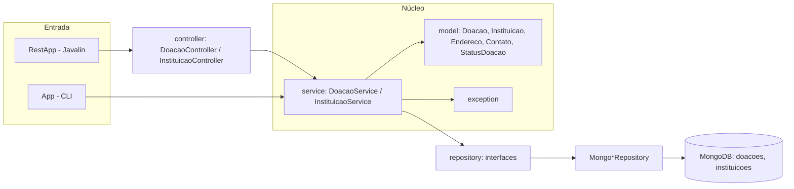

# Arquitetura

Aplicação Java 17 (Maven) em camadas, com duas interfaces de entrada sobre o mesmo núcleo: uma API REST
(Javalin) e uma CLI de console. O banco é o MongoDB.

## Pacotes (`br.com.unicesumar.aep`)

| Pacote | Responsabilidade |
|---|---|
| `model` | Entidades de domínio (POJOs): `Doacao`, `Instituicao`, `Endereco`, `Contato`, `StatusDoacao` |
| `repository` | Interfaces de persistência (`DoacaoRepository`, `InstituicaoRepository`) e implementações MongoDB (`*MongoRepository`) que convertem objeto ⇄ `Document` |
| `service` | Regras de negócio e validações; traduz "não encontrado" em exceção de domínio |
| `controller` | Traduz HTTP ⇄ service (sem regra de negócio) |
| `exception` | Exceções de domínio (`*InvalidaException`, `*NaoEncontradaException`) |
| `config` | `MongoConfig`: conexão única com o MongoDB |
| raiz | `RestApp` (API REST) e `App` (CLI), que montam as dependências |

## Princípios aplicados (POO)

- **Encapsulamento:** atributos privados com getters/setters; validação concentrada nos services.
- **Abstração / inversão de dependência:** services dependem das interfaces de repositório, não do MongoDB.
  Por isso os testes de service usam Mockito, sem banco.
- **Composição:** `Instituicao` compõe `Endereco` e `Contato`; `DoacaoService` compõe `InstituicaoRepository`
  para validar a instituição destinatária.
- **Responsabilidade única:** cada camada tem um papel (ver tabela).

## Erros HTTP

| Exceção | Status |
|---|---|
| `DoacaoInvalidaException`, `InstituicaoInvalidaException` | 400 |
| `DoacaoNaoEncontradaException`, `InstituicaoNaoEncontradaException` | 404 |

Registrar doação com `instituicaoId` inexistente retorna 400 (referência inválida no corpo);
`GET /instituicoes/{id}/doacoes` com id inexistente retorna 404 (recurso do caminho).

## Endpoints

| Método | Rota | Descrição |
|---|---|---|
| POST / GET | `/doacoes` | registrar / listar |
| GET / DELETE | `/doacoes/{id}` | buscar / remover |
| PATCH | `/doacoes/{id}/status` | atualizar status |
| POST / GET | `/instituicoes` | cadastrar / listar |
| GET / PUT / DELETE | `/instituicoes/{id}` | buscar / atualizar / remover |
| GET | `/instituicoes/{id}/doacoes` | doações da instituição |

Especificação completa: `src/main/resources/public/openapi.yaml` (Swagger UI em `/swagger-ui.html`).

## Testes e cobertura

- JUnit 5 + Mockito: services e controllers testados com dependências mockadas.
- **Repositórios MongoDB** testados contra um MongoDB em memória (`mongo-java-server`, só em escopo de
  teste): não precisa de Docker nem de `mongod` instalado, então os testes rodam em qualquer máquina.
  Cobrem o documento aninhado (`endereco`), a lista de subdocumentos (`contatos`) e a referência
  `instituicaoId` (guardada como `ObjectId`).
- **API REST de ponta a ponta** (`RestAppTest`, com `javalin-testtools`): HTTP → controller → service →
  repositório → MongoDB em memória, incluindo o relacionamento entre as coleções e os códigos 400/404.
- **CLI** (`AppTest`): entrada simulada, serviços reais sobre o MongoDB em memória.
- JaCoCo com regra de **mínimo 70%** de instruções (`mvn test` falha abaixo disso).
- Única classe fora da medição: `MongoConfig` (lê variáveis de ambiente e abre a conexão real). Ver `pom.xml`.
