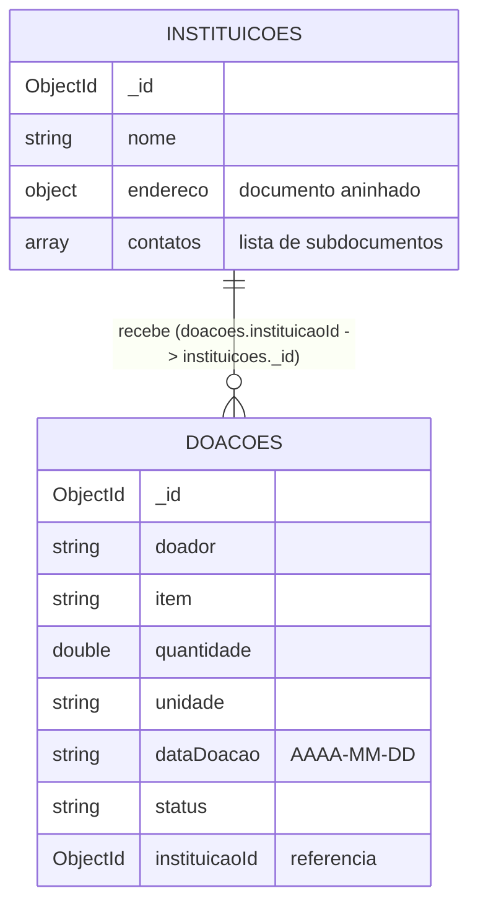

# Estrutura do banco de dados (MongoDB)

Banco: `aep_doacoes` (configurável por `MONGODB_DATABASE`). URI padrão: `mongodb://localhost:27017`
(configurável por `MONGODB_URI`). As coleções são criadas automaticamente na primeira escrita.

## Visão geral



| Requisito do semestre (2º) | Como é atendido |
|---|---|
| Múltiplas coleções | `instituicoes` e `doacoes` |
| Relacionamento entre coleções | `doacoes.instituicaoId` referencia `instituicoes._id` (1 instituição : N doações) |
| Objetos complexos | `instituicoes` tem `endereco` (documento aninhado) e `contatos` (lista de subdocumentos) |

## Coleção `instituicoes`

```json
{
  "_id": { "$oid": "665f1c2e9b1e8a3d4c5b6a7f" },
  "nome": "Banco de Alimentos de Maringá",
  "endereco": { "rua": "Rua A", "cidade": "Maringá", "estado": "PR" },
  "contatos": [
    { "nome": "Ana", "telefone": "44999990000", "email": "ana@ong.org" },
    { "nome": "Carlos", "telefone": "44988880000", "email": "carlos@ong.org" }
  ]
}
```

| Campo | Tipo | Regra |
|---|---|---|
| `nome` | string | obrigatório |
| `endereco` | documento | obrigatório; `rua`, `cidade` e `estado` obrigatórios |
| `contatos` | lista de documentos | opcional; todo contato precisa de `nome` (`telefone` e `email` livres) |

## Coleção `doacoes`

```json
{
  "_id": { "$oid": "665f1d0a9b1e8a3d4c5b6a80" },
  "doador": "Maria Silva",
  "item": "Arroz",
  "quantidade": 10.0,
  "unidade": "kg",
  "dataDoacao": "2026-08-20",
  "status": "PENDENTE",
  "instituicaoId": { "$oid": "665f1c2e9b1e8a3d4c5b6a7f" }
}
```

| Campo | Tipo | Regra |
|---|---|---|
| `doador`, `item`, `unidade` | string | obrigatórios |
| `quantidade` | double | maior que zero |
| `dataDoacao` | string ISO (`AAAA-MM-DD`) | obrigatória, não pode ser futura |
| `status` | string | `PENDENTE` → `RECEBIDA` → `DISTRIBUIDA`, ou `CANCELADA` |
| `instituicaoId` | ObjectId | obrigatório; a instituição precisa existir no momento do registro |

## Decisões e limitações

- **Referência, não embutimento:** doações ficam em coleção própria (crescem sem limite) e apontam para a
  instituição por `instituicaoId`. A integridade é garantida na camada de serviço (MongoDB não tem chave estrangeira).
- **Remoção de instituição:** não bloqueia se houver doações associadas; elas ficam com uma referência
  órfã. É uma limitação conhecida da PoC.
- **Doações da 1ª entrega** (sem `instituicaoId`) continuam legíveis: o campo vem como `null`.
- **Atualização de instituição** substitui o documento inteiro (`replaceOne`), incluindo `contatos`.
